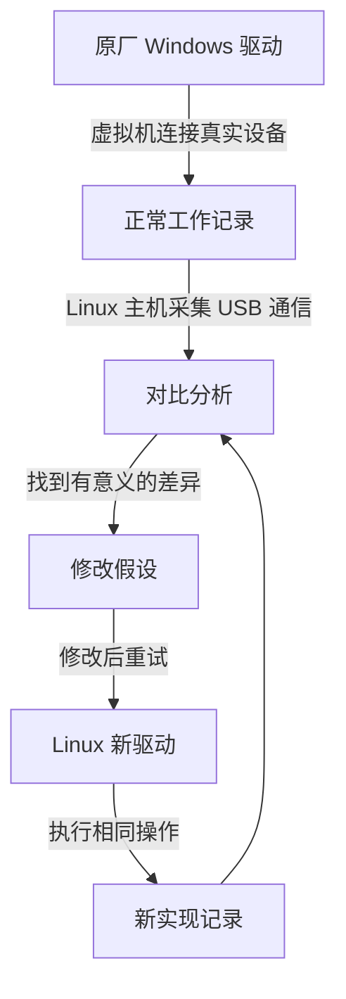

> 本文整理原文与 HN 讨论中的有价值信息，分别保留项目声明、评论者自述与整理者判断，不是全文翻译。

这篇讨论最有价值的信号：AI 让一部分过去不值得投入的兼容性工作变得可行。决定效果的关键，是能否让它操作设备、观察结果，并用可靠的参照纠错。

## 原文究竟证明了什么

原文是 Christian F. K. Schaller 于 2026 年 10 月 15 日发表的《Using Artificial Intelligence to reverse engineer hardware》。HN 页面是讨论入口，读取时显示 257 条评论。

作者买扫描仪整理家中底片，却遇到同型号更换芯片、Linux 驱动不支持的问题。最初尝试停滞数月。让 AI 操作 Windows 虚拟机并采集 USB 通信后，数小时出现第一张可辨认扫描；几天后功能进一步完善。他随后将方法用于笔记本摄像头。

**证据边界**：这是作者在自有设备上的实践报告。我核对了原文、项目文档与部分评论所链接仓库，没有在相应实物上复测。作者也明确表示效果仍有改进空间。

[原文](https://blogs.gnome.org/uraeus/2026/10/15/aiandreverseengineerhardware/) · [HN 讨论](https://news.ycombinator.com/item?id=50104299)

## 最值得复用的方法：给 AI 一个能验证的实验环境

原厂驱动提供正常行为参照。Linux 主机用 `usbmon` 采集虚拟机与真实 USB 设备的通信；新驱动也用相同工具、在相同层采集，便于比较。内置 MIPI 摄像头不能直接套用 USB 抓包，需要设备属性、INF、注册表、ACPI 等资料辅助。

作者公开的 [hw-harness](https://github.com/cschalle/hw-harness) 包含虚拟机控制、USB 抓包、设备切换和主机调试工具。开发测试环境为 Fedora、KVM/libvirt 与 Windows 11 Pro。**它是原有专用脚本的事后通用化版本，原文没有证明发布形态已端到端验证**。

方法文档还有几条容易漏掉的经验：每次实验只回答一个问题；记录操作、分辨率等条件；在条件相同的时候抓取两侧记录；保留设备接入时的初始化过程；先完整采集总线，再过滤分析。

**我的提炼**：比“换一个更强的模型”更可迁移的做法，是提供正常样例、操作权限、观测工具和明确验收条件。模型进步也可能有贡献，文章没有控制变量来分离两者。

[工具与环境要求](https://github.com/cschalle/hw-harness) · [实验方法](https://github.com/cschalle/hw-harness/blob/main/doc/method.md)

## 三项原文成果，各自有什么实际价值

| 成果 | 具体价值 | 使用边界 |
| --- | --- | --- |
| OpticFilm 8200i SANE 后端 | 为 GL128 芯片版本补支持，含红外扫描与除尘 | 同名旧型号使用不同芯片，不能只看商品名 |
| Negative Vibes | 将扫描、底片反转、除尘和导出连成完整工作流 | 实测集中在作者的 8200i；其他设备的红外接口仍有兼容问题 |
| ThinkPad MIPI 修复 | 同时检查内核传感器驱动与 libcamera 图像处理 | 主要针对 X1 Carbon Gen 14 Aura 的 IMX471 + IPU7 组合 |

**扫描仪**：原文报告，全分辨率扫描耗时 34.6 秒，对比上游驱动 54.4 秒；这是单机、单帧结果。上游在作者重试前已经增加相应支持，因此后续价值包括将差异修复回馈上游。保留芯片和 USB ID，是比保留型号名称更可靠的兼容性记录。

[扫描仪仓库：GL128，USB 07b3:1825](https://github.com/cschalle/OpticFilm8200i-sane) · [原文性能比较与限制](https://blogs.gnome.org/uraeus/2026/10/15/aiandreverseengineerhardware/)

**Negative Vibes**：保留扫描仪提供的 16 位线性原始数据和红外通道，将处理作为可修改的设置叠加。可导出 TIFF、JPEG、PNG、DNG。它提示了另一层价值：设备能工作后，还需把零散操作做成可反复使用的应用。

[应用仓库](https://github.com/cschalle/negative-vibes)

**摄像头**：问题横跨裁剪区域、寄存器宽度、模拟增益上限、镜头暗角和白平衡。白平衡错误涉及原生位深与 8 位黑电平的口径不一致。项目报告同条件低光测试亮度从 31.1 到 90.9，约 2.9 倍，但蓝色仍偏低。

更有价值的是实验细节：相同座位和灯光，恢复原版软件重新拍摄，两侧均等待 400 帧，让自动曝光与白平衡稳定。中间版本曾放大偏色，说明画面变好或变差都不能直接定位根因。

[五项缺陷、对照图与测量](https://cschalle.github.io/mipi-fixes-x1-aura/)

## 评论里最有价值的争议：几小时复制算法，意味着什么

一位自称经营音频效果器公司的评论者称，他在短时间内逆向多个竞争产品，包括 Strymon Big Sky、Lexicon 224 和 Ursa Major。他描述的验收路径值得保留：先做模拟器运行原固件，再转为独立 C++ 库，并与模拟器比较。**完成范围、耗时与等价程度仍是其个人陈述**。

[音频厂商评论](https://news.ycombinator.com/item?id=50104955)

随后，一位自称相关 Lexicon 模拟项目作者的人补充：先付费请人将原理图转录为 KiCad，再用模型生成 Verilog，期间发现和修正大量小错误，花了几个月。

**我的判断**：“最后一人几小时完成”与“从零需要几小时”应分别记录。快速结果可能包含已有逆向成果、人工准备与工具链积累。这并不否定提速，但会改变你对难度和可复制性的判断。

[项目作者补充](https://news.ycombinator.com/item?id=50111576)

两个相关仓库也不能混为一谈：

- [reflecticon-224](https://github.com/joelanders/reflecticon-224)：运行原机固件的模拟器，可在浏览器或插件中使用；ROM 由用户自行提供。文档仍在完善。
- [reverb-80](https://github.com/reverse32159/reverb-80)：包含算法说明和 200 个出厂程序的数据，仓库明确表示不含音频处理实现，不能直接拿来处理声音。

**一个判断习惯**：看到“完整复现”时，先分清交付的是说明文档、可运行程序、原固件模拟，还是经真实设备对比的重实现。

## 旧设备复活：哪些是实际项目，哪些只是自述

| 方向 | 讨论中的成果 | 证据状态 |
| --- | --- | --- |
| 老 DV 摄像机与采集盒 | MarvinCapture 为部分 Pinnacle MovieBox 设备提供现代采集程序 | 已核对公开仓库与支持列表 |
| 音频历史设备 | reflecticon-224 模拟 Lexicon 系列 | 已核对仓库，仍需用户提供 ROM |
| NVIDIA 显卡与 macOS | NullMoth 项目提供 Metal 驱动及相关组件 | 已核对 README，适用 Intel/x86_64 macOS 15；未实测 |
| 打印机、Wacom、MP3、路由器 | 评论者自述补驱动、解码协议、写固件或移植 OpenWrt | 本次未取得足够复现证据 |
| 手机远控 ATEM 切换台 | 评论者称做出局域网 Android 遥控程序 | 属于厂商 SDK/协议集成案例，不宜全部归为硬件逆向 |

**MarvinCapture 尤其有保留价值**：特定 MovieBox 设备把原始 DV 数据封装到 USB，不必先转换为模拟画面。项目有 Mac/Windows GUI 与跨平台 CLI。支持列表中，500-USB 和 510-USB 标为已测试，另外几款仍未测试。不能将它理解为普通 USB 转 FireWire 线都能做到。

[MarvinCapture 与硬件列表](https://github.com/JonasCz/MarvinCapture)

**NullMoth 的边界也很明确**：README 描述 Intel Mac 和 OpenCore PC 的方案，主要测试卡为 RTX 5060；这不表示 Apple Silicon Mac 已普遍支持 NVIDIA 显卡。

[NullMoth 项目说明](https://github.com/nullmoth/nvidia-macos-driver)

**我的提炼**：最值得优先尝试的是手头有实物、能找到正常工作参照、收益明确的小任务。冷门设备可能等不到商业支持，但拥有者自己有动力补最后一段兼容性。

[其他设备案例与讨论](https://news.ycombinator.com/item?id=50104299)

## 商业上值得保留的四个判断

**逆向门槛下降，首先改变的是成本与回本周期**。过去能被复制但不值得复制的产品，现在可能值得。这与“所有技术优势立即消失”有很大距离。

**品牌、操作体验、可靠性和售后仍可能收费**。评论以效果器的实体旋钮、现场稳定性等为例。不过，知名品牌的存续不能直接证明小厂也安全：小厂可能还没有客户基础，模仿者也能改善做工。

**开源与原创仍有成本归属问题**。可复制成果能减少重复劳动，但最初研究和持续维护由谁承担，并不会自动解决。社区贡献、支持服务、预付众筹等是讨论中的候选机制，尚无统一答案。

**收益可能向另一层迁移**。有评论指出，应用和算法更容易复制时，创作者与复制者仍可能同时向闭源模型平台付费。因此，“旧知识壁垒变薄”不能直接推出“价值分配更分散”。这是值得追踪的推论，讨论没有证明最终格局。

[商业分歧所在讨论](https://news.ycombinator.com/item?id=50104299) · [模型平台收费与权力迁移的反驳](https://news.ycombinator.com/item?id=50111346)

## 阅读时需要过滤的推论

**工程上分清三种目标**：观察协议后写兼容驱动；运行或翻译既有固件；根据输入输出做行为近似。它们需要的证据和交付物不同，不能都用“AI 破解硬件”概括。

**安全能力没有被这篇文章判死刑**。评论对加密、读保护和黑盒复制争论很大。有限样本下复现一种效果，不等于在所有状态下精确恢复算法；讨论中的个别成功案例也不能证明所有设备都能被同样处理。

**法律意见保留为未决分歧**。评论争论了逆向、版权、许可和专利，但没有统一司法辖区或完整案情。本次不把“AI 改写后即可任意出售”“开源许可已经失效”等说法列为事实。

**具体时间和费用不要当预算**。“20 分钟”“0.86 美元”等属于个人故事。没有会话、输入资料、失败记录、测试范围和完整成本，无法据此估算自己的任务。

[以上争论的原始上下文](https://news.ycombinator.com/item?id=50104299)

## 对实际工作最有用的落点

以下是我的归纳，属于可从这些案例推导的工作建议。

**先收集可观测性，再扩大自动化**。准备真实设备、硬件版本、正常工作路径、操作记录、日志和输出样本。用一个最小操作建立对照，证明 AI 能提出假设并通过实物纠错后，再扩到完整功能。

**把完成标准写成真实使用结果**。驱动编译通过只是中间结果；扫描仪要看扫描、颜色和重复操作，打印机要看分页、缺纸与双面，远控工具要看发现设备、执行和恢复。

**先查上游，再维护自己的分支**。原文作者重试时，上游已经支持扫描仪。将自己的差异与上游比较、提交缺失功能，可能比长期保留两套驱动更有价值。

**把这篇文章读成一次成本结构变化**。更低的实现成本，让个人能为自己的冷门需求补软件。持续维护、跨版本适配和可靠交付，仍需单独解决。

原文、工具、项目与关键评论的链接均随相关段落附上。公开仓库的存在与 README 声明，不等于本次已完成实物验证。
