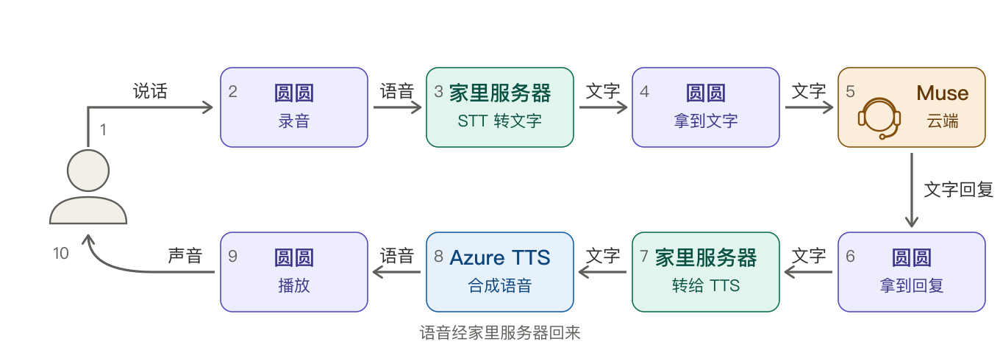
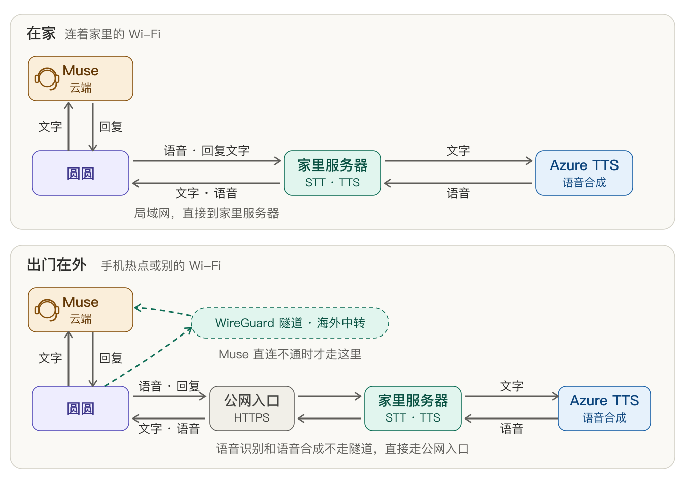
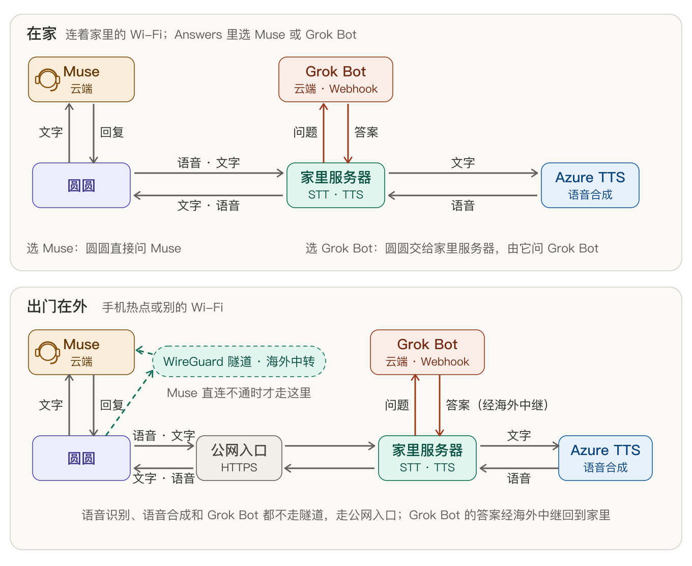
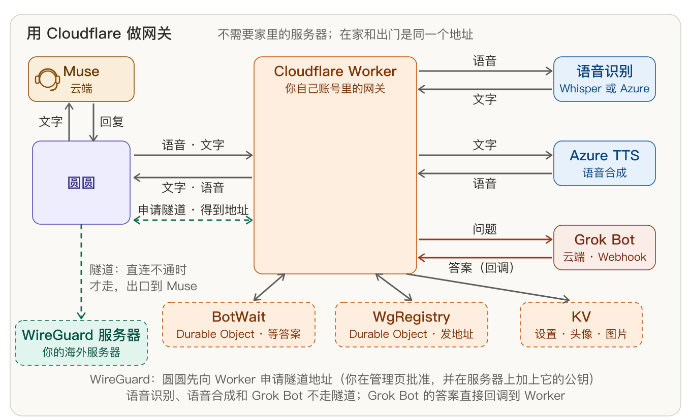

这里的保姆是我，ESP32 设备就是那个需要呵护的孩子。本文不是 ESP32 保姆级教程，而是一篇玩 ESP32 设备的心路历程。

我有五个 ESP32 设备，两个成品：微雪 ESP32 1.75c （圆圆）和 M5Stack StopWatch。三个裸板：一个 ESP32 S3，两个 C6，今天说这两个成品折腾记。成品的意思就是这玩意是一个完整的产品，包含屏幕电池芯片外壳和出厂固件，开箱即玩，裸板的意思是给你板子，线都需要自己接。

圆圆刷的第一个固件是 Muse，用一个小设备跟云端 Person Agent 对话挺 Geek 的，这也是我买的主要原因。刷完 Muse 固件后，圆圆就变成了 Muse Gadgets 的一个设备了，可以和 Muse 对话。Muse 用了两三周了，在我看来算一个合格的个人助理了：记得我问过的事，记得讨论的内容，会主动跟我说话，比如北马前三天就提醒我该买胶了，提醒我预约领物时间，周六会下雨，周日天气不错，周五是最后可以慢跑的时间了。成年人都挺忙的，别人的事不会记得那么清楚，也不会那么上心，Muse 虽然是个机器人，但是能主动记得这么多琐事而且提醒，不是也挺让人惊喜和感动的吗。

刷完 Muse 问题就来了，回复的文字不会语音播报，直接在小屏幕上一行一行的给你看，这眼睛都要看瞎了，让 Muse 直接用语音回复，Muse 在云端现下载 edge-tts 合成，地主家也没余粮啊，也去薅微软的羊毛。有时候语音识别和合成会失败，我的问题三十分钟还没合成完，各种卡顿，各种环境问题。AI 时代，自己动手丰衣足食。

## 语音播报

语音播报功能就是让圆圆能把回复读出来。圆圆处理能力有限，这个任务就交给家里的服务器或者云端吧。Azure 的 TTS 功能，每个月有一定的额度，个人轻量使用应该够了。既然这个都做了，顺便把 STT 也加上：把语音识别工作放在本地，Muse 收到的是文字，而不是语音，这样就不用在云端转译了，能加快响应时间。家里有一台 Linux 服务器，可以充当圆圆的中转站。

每次我用圆圆跟 Muse 说话，语音先发到家里的服务器上，通过一个很小的 STT 模型转成文字，然后把文字回传给圆圆，圆圆把文字发给 Muse，Muse 的文字回复到达圆圆后，圆圆会把文字传给家里的服务器，由家里的服务器转给 Azure TTS 服务合成语音，再传给圆圆播放。STT 走本地是因为本地模型水平足够好了，速度也快，几乎没有错字，就是有错别字 Muse 也能理解。TTS 走云端是因为 T 本地模型我的服务器跑不动，Azure 提供足够多的音色，免费够用，而且速度也不错。

整个流程如下：

## 接受文字

Muse Gadgets 设备居然没有文字接受功能，也就是说圆圆发起聊天，Muse 能回文字，能会语音，但是 Muse 不能主动的给圆圆发一段文字或者语音，因为圆圆注册的时候，没有注册这个能力，只能注册了图片接受能力，这就很奇葩了，能接受图片而不能接受文字。这个功能比较简单，修改代码，然后让圆圆向 Muse 注册，说我新加了这个能力，Muse 刷新圆圆能力后就可以主动发文字给圆圆了。这里还有一个小的功能：播报所有信息。打开这个功能后，Muse 发给你的消息不止会在 App，网页里显示，圆圆也会同步播报出来，如果没有心里准备会被吓一跳，谨慎打开这个功能。

## 头像更改

圆圆的头像看久了也腻了，Codex 桌宠那种像素风挺适合圆圆的，让 Codex 把小段的头像做成像素风，和 Grok Bot 一起放进固件里，做成可更换的菜单。

## WireGuard

如果想随时随地的和 Muse 聊天，分流是个绕不开的话题，在家尚能通过路由器解决，在外只能通过隧道了，ESP32 支持 WireGuard，固件加上 WireGuard 后，在程序里做一个判断：如果圆圆连的不是家里的 Wi-Fi，那么和 Muse 的连接走隧道，家里宽带也有公网地址，绑了域名，STT 和 TTS 可以走公网回家处理。当然你需要有一台能访问 Muse 的服务器。

流程如下，这些判断都是在固件里写死的，包括家里的 Wi-Fi SSID，直接刷进设备里，没有给设备太多的配置空间，因为屏幕太小，配置起来太麻烦。

## Grok Bot

Grok bot 并不原生支持 Muse Gadgets 设备连接，但是支持 Webhook 调用。解法就出来了：在服务器上部署 Webhook 服务，把 Gadgets 设备发的消息通过 post 的方式转给 Grok bot，把回传的消息合成转给 Gadgets 设备。让 Grok bot 生成 Webhook URL，Webhook 密钥，同时把你的服务器地址加入白名单。

圆圆的固件里加上 Muse 或者 Grok bot，固件会根据你的选择把消息发往对应的服务器。

流程如下：

## 网关模式

我这一套服务严重依赖于家里的服务器，圆圆的网关在家里服务器上，STT 和 TTS 在服务器上，如果其他人想用这套服务怎么办，总不能也连我的服务器吧。网关模式出炉了，可以把网关部署在 Cloudflare 上。Cloudflare 负责路由 STT，TTS，Grok Bot 请求去对应的服务器。网关的管理页面管理 STT、TTS、Grok Bot 配置、WireGuard 等。

这一套操作下来你可以全天候无死角的和 Muse 以及 Grok Bot 聊天了。

## 计时器，Badge 及其他

圆圆设备空间其实挺大，只放一个服务挺亏的，于是又做了倒计时，计时器，时钟，Badge 功能，我只能说我的 Claude Code 额度用的从来没有这么快过。

## 保姆的碎碎念

忙忙叨叨两星期，加了一个又一个功能，你说我这不是保姆是什么，今天觉得 OK 了，明天可能又冒出一个，请叫我北下关点子王。

为什么失业在家不努力投简历找工作而是折腾这个，因为我需要创造，找点新的事情做，而不是天天无聊的刷招聘网站，寻找莫须有的希望。

话说做到现在最后怕的其实是这个过程中暴露了太多的信息给 Claude Code，神马分流，神马海外服务器，老哥发起狠来分分钟把我干掉。

最后的最后，项目在这里，目前支持微雪 ESP32 S3 touch 1.75c 和 M5Stack StopWatch，有兴趣可以刷来玩玩，把项目抛给你的 Agent，连上你的 ESP32 设备，Enjoy it。

https://github.com/burndown/esp32-twinmate
