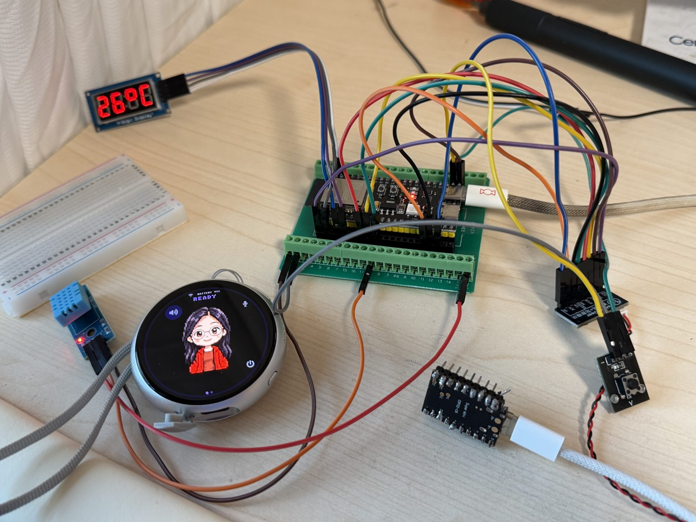

种草是个慢功夫，尤其是像我这样的中登，经济上还好，一两百的东西买起来也不眨眼，但是折腾是要花时间的。

我早就被各种渠道种草了 ESP32，知道这玩意可玩性高，因为我买过一个 Micro:bit 套装，有几十个传感器，有按钮，有喇叭，有风扇，有温度湿度传感器，还有一本教材，教你怎么玩。理论上 Micro:bit 能用的传感器，ESP32 也能用，不幸的是这个套装到货后我就没兴趣了，拆开后一直被放在家里的一个角落，直到 ESP32 到来。

下定决心买一个 ESP32 玩是被 Muse 种草了，Muse 是 Meta 的个人助理系统，跑在云端的服务器里，能跑各种小任务，也能和各种服务连，Gmail 啊啥的，话说 Muse 确实有点东西，知道我这周日要跑北马后每天都会给我发小 tips，什么胶准备好了没有，我在京东给你找了链接。领物前记得在 App 里预约，记得签什么参赛协议。怎么说呢，真有点个人助理的意思。Codex 和 Claude Code 也很强大，但是他们不关心人，他们只会在你打开的时候才会干点活，不会主动蹦出来帮你做点啥。这个东西叫主动性或者 motivation，外企最看中这个。

扯远了，Muse 推出了一个开源项目 [Muse Gadgets](https://gadgets.muse.ai/)，就是可以通过一条加密通道把 ESP32 或者 Linux 设备和 Muse 连起来，你可以通过这些设备跟 Muse 对话，Muse 本来在云端，在网页里，在手机 App 里，现在有了这个，相当于有一个物理的终端在你桌面上。你可以随时跟他们对话，消息送到 Muse 那里，处理完后返回，当然不止于对话，如果你的设备支持其他服务，Muse 也能帮你调用，比如你的 ESP32 设备能控制家里的智能家居，那么跟 Muse 说，打开厨房的灯，我要做饭，这条指令能通过 ESP32 送到 Muse，Muse 查找你的设备发现能干，就会发指令给设备来操作，有点脱裤子放屁的意思，但是有点好玩不是吗？谁不梦想用自然语言控制家里的一切呢。好巧不巧的是我前一阵子刚好把家里所有的开关都换成了智能开关，本来是通过 iPhone 家庭控制了，现在 Muse 也能干，多好，我甚至省了喊 Siri，哦，不对，跟 Muse 说话要按一个按钮。我们天天瞎折腾的人就有一个问题，家里智能家居太少不够四五个人工智能帮我们折腾的。ESP32 也能做出来很好玩的桌面小玩意，所以一拍即合，一个 ESP32 设备 = 一个人工智能 + 智能家居开关 + 桌宠，我买了。

因为 ESP32 型号太多，我索性买了好几样，有 Muse Gadgets 官方演示的微雪 1.75c（简称圆圆），有一个 ESP32 C6 supermini（下文简称 C6），有一个 ESP32 S3（简称方方），圆圆就用来刷 Muse，C6 看看能不能自己手搓一个人在传感器， E 方方不知道具体干啥，买了再说，板子很便宜，一个几十块钱。编程啥的我不会，也没想学，但这不是有 Claude Code 和 Codex 呢，他们俩啥不会啊。

咱们一个一个的讲，最早开始折腾 C6，C6 很小，半个大拇指大，有十几个 GPIO 接口，通过 USB Type-C 供电，我用杜邦线接了一个人在传感器，然后让 AI 帮我把固件刷进去，AI 识别出来后几分钟就搞定了，功能实现的挺好，能够发现有没有人，但是我发现一个重要的问题，我这个 C6 和传感器没有焊排线，接的时候需要把杜邦线线头折弯挂在接口上，有时候没有固定好就断了。我搜了一下大家都是怎么固定，入门玩家用面包板，高级玩家都是自己画 PCB 固定，但是人家都有排针，我啥也没有，就一块裸板，我只好下单了焊枪，排针，自己动手焊。没想到这就是悲剧的开始，不知道是工具的拉胯还是我手残，我焊了一中午也没焊出来人家那种小小的精美的焊点，每个排针都被一大坨锡糊住了，但是也没固定好，而且两根排针也不平，高高低低的，甚至都放不平，拍给 AI 看，他建议我拆了重焊，但是我拆也拆不下来，只能让排针错落有致的堆在 C6 上，人在传感器也没好到哪里去，焊完后我试图把他们接起来甚至发现一个排针掉了。这里还要提一个知识点，杜邦线有公对母，母对母，公对公，我之前只有公对公，因为焊上排针后需要母对母，我又下单了杜邦线。焊好了接起了怎么都不行，C6 读不在人在传感器的数据，AI 说你虚焊了，建议重焊，我又拆不下来，甚至用力过猛把一个接口都扯掉了。天无绝人之路，我在路上看到说 Home Assistant 26.10 支持 ESP32 通过扫描 WIFI 的信号变化来检测是否有人运动，这也太好了，我再也不用担心虚焊和人在传感器的破事了。刷上后发现一个重要的问题，房间里任何人的运动都能引起 WIFI 信号的变化，我想检测卧室里的信号变化，但是我在客厅里的走动也能引起卧室里的信号变化，C6 判断卧室里有人了。这不对啊，我只是要检测卧室里的走动，现在全屋有一个人都不行，弃了弃了。网上还有一个项目，把 C6 刷成一个 DNS 屏蔽装备，所有 DNS 请求经过一遍过滤，把广告都屏蔽掉，我的路由器上跑着 OpenClash，我觉得可能有兼容性问题，没尝试。

接着说圆圆，这个设备的主要目的就是刷 Muse Gadgets，全程由 AI 代劳，刷完后我发现也是个半成品，屏幕这么小，回来的对话居然只能用文字显示，不支持 tts，你让他朗读个东西，Muse 在云端折腾十几分钟通过 edge-tts 转成 mp3 发过来，真是太辛苦了。好在 Gadgets 的代码是开源的，AI 是给力的，直接修改源码，让返回来的文字通过微软的 tts 转成语音念出来，为了进一步加快速度，还在家里的服务器上部署了 Speech to text（stt）服务，我说话，调用家里的服务转成文字，发给 Muse，Muse 回应，调用微软 tts 转成文字念出来，整个一个 home maded 电子宠物。我还试着把 Muse Gadgets 接到其他 LLM 上，没问题，但是每次都调用 api，没有记忆功能，不好玩。

最后，缝合了好几样东西到这个小设备上：发消息用 SenseVoice 做本地识别，Muse 的回复用 Azure 的 TTS 朗读，Muse 推送过来的消息都会大声朗读出来，定制了个人头型。这个小玩意才勉强达到我心中的要求，顺便吐槽一句，官方代码里，Gadgets 设备能接受图片不能接受文字，所以让 Muse 发一段文字到圆圆上，Muse 会先转成图片，然后发过来，真真把人看瞎了。不过咱也不含糊，有啥需求直接提，AI 直接安排上。

方方（S3）折腾的比较多，通过扩展板接了几个外设：温度湿度传感器，功放和喇叭，一个数码管，一个按钮。刷过 Muse Gadgets 系统，同时让 AI 做了一个桥接服务（HA bridge），把 Home Assistants 里的服务暴露给方方，这样方方能控制他们，这个控制能力也推送给了 Muse，这样 Muse 知道连的这几个设备有什么能力，能控制他们。所以一个脱裤子放屁的控制链路是这样的，我对圆圆说，关闭客厅的灯，圆圆把语音发给运行在家里服务器的 STT 识别成文字，发给 Muse，Muse 查了一下连接的设备，发现方方有这个能力，就把请求转发给方方，方方通过 HA brige，把请求发给 HA，HA 再通过智能家居的网关，把灯关了。也是为美国的算力消耗做了一点微不足道的贡献。还折腾过离线 stt 和 tts 的固件，怎么说呢，就是玩具吧，干不了什么大事。

国内一个比较火的 ESP32 智能项目叫小智，ESP32 接受语音输入，通过 STT，LLM，TTS，给你答复，简单试了一下，太丑，在我的圆圆上字都显示不全，没法看，UI 方面，Muse 甩他们五条街，但是这个项目也有一定的可取之处，就是有一个服务器后端，所有的模型都可以自己设置，这个思路可以借鉴。

方方还刷了一个 Hermes 系统，后端是 Hermes，用语音和 Hermes 对话，Hermes 跑在家里的服务器上，stt 用的 SensesVoice，tts 用的 Azure 的，LLM 用的 OpenAI 和 Gemini 订阅，那个速度快走那个。怎么说呢，还在玩。

生命不止，折腾不休，我会继续折腾的。

补一个全家福：

圆圆，方方，以及焊的乱七八糟的 C6

