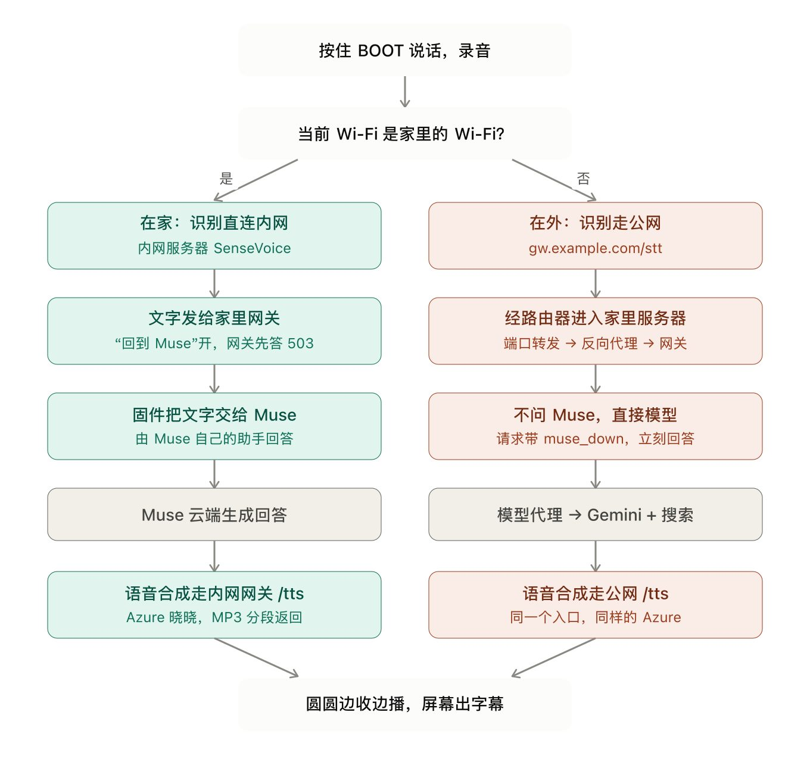

微雪 ESP32-S3-Touch-AMOLED-1.75C 是我买到的第一个 ESP32 设备，这个完全是被 [Muse Gadgets](https://gadgets.muse.ai/) 种草了，买来准备和 Muse 互联，作为我的随身小助理。为了方便起见，以后称这个设备为圆圆，相对应的是一块 ESP32 的裸板 - 方方。

设备很小巧精致，握在手里有圆润的感觉，像一块鹅卵石，把玩几下开始干正事，刷机。

接上电脑，连上 Claude Code，告诉他检查连接的 ESP32 设备，帮我刷成 Muse Gadgets 设备。不得不说 Opus 5.5 和 Sonnet 5.5 之后算王者归来了，水平很高。Claude Code 指导我去拿了 Gadgets Token 之后就开始刷机，中间几乎不用我参与，刷好之后就是配对和 Muse 互联，这里网络需要能访问 meta，把下边几条规则加入你的分流软件，其他的一般的域名规则里都有， `metaivm.com` 是 Muse 之后新加的，从这个域名也能看出，Muse 运行在一个 VM 里，不知道 VM 是传统的 VM，还是现在的各种轻量级的 sandbox。

```
DOMAIN-SUFFIX,meta.com
DOMAIN-SUFFIX,muse.ai
DOMAIN-SUFFIX,facebook.com
DOMAIN-SUFFIX,meta.ai
DOMAIN-SUFFIX,metaivm.com
```

用上之后我发现这个系统完全是个半成品，比如 Muse 返回来的消息不能语音播报，只能用文字显示，大哥，1.75 这个屏幕，谁能看清楚字啊，欺负我们这些老年人。好在代码是开源的，AI 是万能的，我下的第一个命令，让 Claude Code 把加上回复转成语音的功能，用的微软 Azure 的 TTS，一个月有不少免费额度，速度还比较快，轻度使用够了。改完语音播报，第二个需求又来了，能不能把默认的头像换了，换成媳妇的，这样聊天欲望更有沉浸感。这样需求一个接着一个，Claude 都帮我实现了。

圆圆虽好，但是只能在家里玩，能不能出门连上公共 Wi-Fi 或者热点的时候也能正常使用？这个手术有点大，跟 Claude 讨论后，方案如下，如果设备连的是家里的 Wi-Fi，那么走官方的服务器，跟云端的 Muse 通信。如果连的不是家里的 Wi-Fi，那么整个请求都要换了，我家里刚好有一台 Linux 服务器，运行了一些服务，可以给圆圆使用，整体架构如下：



我家里是有公网 IP 的，所以我运行了一个 ddns，绑了一个阿里云的域名，这样在外边也能访问家里的服务器。

从这个图里也能看出来，如果你不在家，那么走的是 LLM API 的询问，不带任何记忆，就丧失了 Muse Gadgets 最大的优点，就是跟云端的 Muse 互通，作为你个人助理的一个延伸，换句话说，圆圆不认识你了。因为 ESP32 硬件水平的限制，没办法再跑一个分流代理，所以在公网上也只能这样了。

我个人对 Muse 还是比较满意的，真的算一个个人助理了，比如他知道我跑最近要跑马拉松后，提前就提醒我买胶，预约领物，注意休息和充碳。这不是一个被动等你提问的助手，而是在背后默默的记录下一切，会主动帮你考虑的助手，我真的是又被关心到。我现在几乎没连什么服务，所以 Muse 对我的了解只能通过我和他的聊天，如果我让 Muse 连了社交媒体，邮箱等一堆服务，那么 Muse 对我的了解可能超过我自己。

总结了一下我对圆圆的改造：
- 语音播报 Muse 的回复。
    Muse有发一段语音给圆圆的能力，但是合成语音用的edge-tts，速度巨慢，还有失败的风险，我索性把这个服务放在圆圆这边，圆圆收到文本回复后通过家里的服务器去Azure请求语音。
    
- 不在家的时候，自动使用家里的服务而不是 Muse。
    家里服务器跑了一个网关，可以自定义STT和TTS的服务商，TTS用的Azure，STT是在本机跑了SenseVoice，识别中文非常快，为什么不把语音直接发给Muse，因为Muse也要STT，而且速度也慢，我索性把这块服务也放在本地了，只为提供和Muse对话时的速度。Muse接收文本，处理，回复文本，本地做stt和tts。
- 添加了接收文本的能力。
    这里比较有意思，Gadgets支持什么能力是需要让Muse知道的，Muse知道后才能使用这个能力。之前圆圆只能在问问题的时候才能接收文本，Muse不能从远端主动发一堆文字给圆圆。代码需要添加文字接收能力，然后通知Muse，Muse才会发文字过来。每个设备都能宣称自己拥有什么能力，Muse会根据你支持的能力来发指令过来，比如方方连了家里的Home Assistant，他向Muse注册的时候告诉Muse，我能控制家里的灯，那么我让Muse关客厅灯，Muse就会把指令发给方方

云端的 Personal Agent 算一个缸中之脑，Gadgets 设备相对于一个嘴巴，虽然有 web，有 app，但是我还是挺喜欢用这个设备和 Muse 对话，按下按键说话，等着回复。让我有一种老派的和个人助理对话的感觉。
